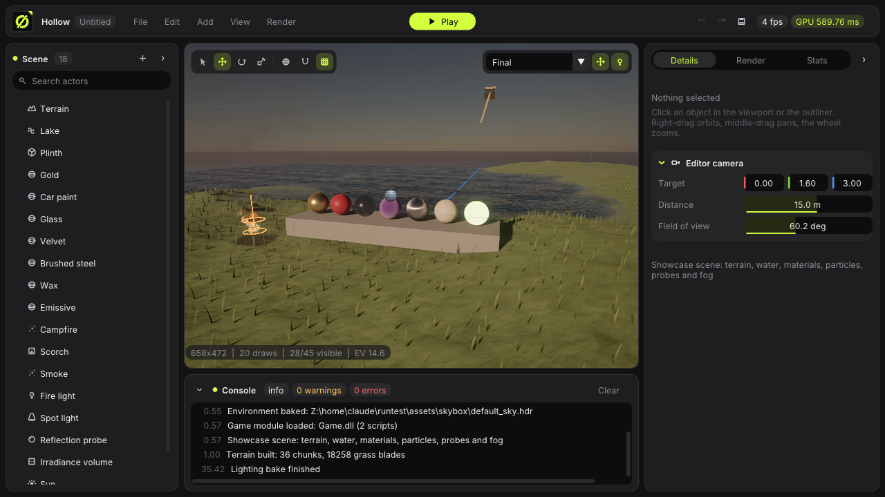

# Hollow Engine

**v0.4** — a native C++20 / OpenGL 4.5 game engine and level editor, built from scratch.

Hollow Engine has a GPU-driven, physically based renderer (clustered forward+, cascaded and atlas shadows with PCSS, a physical sky, reflection probes and irradiance volumes, SSR, GTAO, volumetric fog, TAA with upscaling, and a full HDR post stack), wrapped in a Dear ImGui editor with a scene hierarchy, property inspector, gizmos, undo/redo and scene files. On top of that sit the runtime systems a game needs: input with action bindings, a Play mode with a fixed-step loop, Jolt-powered physics with a character controller, skeletal animation, and C++ gameplay scripts in a hot-reloaded game DLL.

It targets Windows: windowing/input is a hand-written Win32 + WGL layer (no GLFW/SDL), GL 4.5 core is loaded with glad, and textures are decoded with the Windows Imaging Component.



## Features

**Engine systems**
- **Scene graph** — actors with parent/child transforms and components: Static Mesh, Light, Camera, Rigid Body, Collider, Character Controller, Script, Reflection Probe, Irradiance Volume, Decal, Particle Emitter, Terrain, Water, Animator.
- **Scene files** — `.hscene` (JSON, format version 2): actors, components, materials, environment, camera and render settings, with relative asset paths. Version-1 files are migrated on load (light units, exposure, render settings).
- **Property reflection** — each component and settings struct describes its fields once (`describe()`); that one description drives JSON save/load and the inspector UI.
- **Undo/redo**, an **asset manager** with shared meshes, an **input** system with named actions/axes, and **Play mode** (Play/Pause/Step/Stop, fixed 60 Hz physics, scene restored on Stop).
- **Scripting** — native C++ `Script` classes with editable parameters and `on_start` / `on_update` / collision and trigger enter/exit callbacks. Your gameplay code lives in **Game.dll** (`engine/game/`), which the editor loads at startup and **hot-reloads** when you rebuild it. Built in: `Rotator`, `Oscillator`, `PlayerController`, `FollowCamera`, `Collectible`; the sample module adds `JumpPad` and `Hover`.
- **Physics** ([Jolt Physics](https://github.com/jrouwe/JoltPhysics)) — rotating rigid bodies (dynamic / kinematic), box, sphere, capsule and mesh / convex-hull colliders, terrain height fields, triggers with enter/exit events, 8 collision layers with a layer matrix, continuous collision, raycasts and overlap queries, and a **Character Controller** (capsule that slides along walls, climbs steps and slopes and pushes bodies).
- **Animation** — glTF skins and animation clips (step/linear/cubic), clip crossfades, GPU skinning with motion vectors; animators can preview in the editor.
- **Asset import** — glTF 2.0 / GLB and OBJ (+MTL): node hierarchies, embedded or external textures, skins and animations, and the PBR material set including most `KHR_materials_*` extensions and `KHR_texture_transform`. Textures load from PNG / JPG / TGA / BMP (WIC), DDS and KTX2; Radiance `.hdr` environments.

**Rendering**
- **Foundations** — OpenGL 4.5 core with DSA, UBO/SSBO/compute everywhere, an sRGB-correct pipeline, reversed-Z infinite projection, BC1/BC3/BC4/BC5 texture compression with a disk cache, DDS/KTX2 loading, async texture decoding, per-pass GPU timers.
- **Render graph** — passes declare what they read and write; unused passes are culled, transient textures are pooled and aliased, and barriers are inserted automatically.
- **GPU-driven geometry** — every mesh lives in one shared vertex/index pool; a compute pass culls instances (frustum + two-phase Hi-Z occlusion), picks LODs (auto-generated with quadric simplification) and writes indirect draws, so each material batch is one `glMultiDrawElementsIndirect`.
- **Lighting** — physical units (lux, lumens, color temperature, EV100 camera exposure with histogram auto-exposure), clustered forward+ for lights, decals and probes, cascaded sun shadows with blending and texel snapping, a buddy-allocated shadow atlas for spot/point lights, PCF or contact-hardening PCSS, screen-space contact shadows.
- **Global illumination** — Hillaire physical atmosphere (or an HDRI / flat color), reflection probes (box-projected, baked in the editor), irradiance volumes (L1 SH, multi-bounce bake), SSR, GTAO with specular occlusion.
- **Materials** — metallic-roughness plus clearcoat, sheen, transmission + volume, subsurface approximation, anisotropy, parallax occlusion mapping, specular anti-aliasing; most `KHR_materials_*` extensions are imported.
- **World** — procedural terrain with chunked LODs and slope/height layers, GPU-culled wind-animated grass, Gerstner-wave water with refraction, absorption and foam, clustered projected decals, GPU particles with soft depth fade.
- **Transparency** — weighted-blended order-independent transparency or sorted blending; refractive glass and water sample a mip-chained copy of the opaque scene.
- **Post** — TAA / temporal upscaling with CAS sharpening, depth of field (physical CoC), motion blur, bloom with lens dirt, volumetric fog with light shafts, a 3D LUT that bakes white balance, lift/gamma/gain, contrast, saturation, an optional `.cube` LUT and the tonemapper (AgX, AgX Punchy, ACES, Khronos Neutral), plus vignette, chromatic aberration, film grain, dithering, and optional FXAA.
- **Shaders** are files under `engine/shaders/` with `#include`, compiled into permutations on demand and hot-reloaded when edited (or `Shift+F5`).
- 15 debug views: albedo, normals, direct/indirect lighting, reflections, roughness, metallic, AO, emissive, velocity, light complexity, shadow cascades, LOD levels, instances.

**Editor**
- A dark grey / neon lime theme with rounded cards and animated collapsible sections; resizable panels (drag the gaps; double-click to reset), remembered between sessions
- Top bar with menus, Play controls, undo/redo, frame time and GPU time
- Outliner (search, drag-and-drop parenting), inspector with Details / Render / Stats tabs, console with level filters, floating viewport toolbars
- Move/rotate/scale gizmos with hover highlighting, local/world space and snapping; selection outline; light, camera, probe and volume icons
- Render settings for every pipeline feature, GPU pass timings and render-graph resource stats
- Bake lighting (probes + volumes) from the Render menu; drag-and-drop models, `.hdr` skies and scenes
- Capture mode: turntable orbit + skybox playlist, hideable UI

## Building

Requires Visual Studio 2022 (any edition) with **Desktop development with C++**, and CMake 3.24+.

```powershell
.\build.bat                 # optimized build with symbols -> build\RelWithDebInfo\bin\
.\build.bat Debug           # debug build -> build\Debug\bin\
.\build.bat Release test    # build and run the engine tests
```

Then run it:

```powershell
.\build\RelWithDebInfo\bin\HollowEngine.exe
.\build\RelWithDebInfo\bin\HollowEngine.exe engine\assets\scenes\physics_demo.hscene
```

The build produces three modules next to each other: `HollowRuntime.dll` (the engine runtime: core, assets, scene, physics, scripting), `HollowEngine.exe` (editor + renderer) and `Game.dll` (your gameplay code, from `engine/game/`). Every push is built with MSVC (Debug + Release) and tested by GitHub Actions (`.github/workflows/build.yml`).

Any model, `.hdr` or `.hscene` path on the command line is opened at startup. Two flags help with captures and debugging: `--showcase` opens the rendering showcase scene and `--debug-view=N` starts in debug view `N`. You can also open `engine/` directly in CLion or Visual Studio as a CMake project.

The engine needs an OpenGL 4.5 core driver (any desktop GPU from roughly 2014 on). Shaders are read from `engine/shaders/` in the source tree while developing (edits hot-reload), and from the `shaders/` folder copied next to the executable otherwise.

## Try it

1. **File > New Showcase Scene** builds the rendering showcase: terrain with grass, a lake, a material gallery (gold, car paint, glass, velvet, brushed steel, wax, emissive), a campfire with particles and a scorch decal, local lights, a reflection probe, an irradiance volume and volumetric fog. Lighting bakes automatically within a few seconds (the viewport shows a *Baking lighting* chip).
2. **File > New Demo Scene** (or `engine/assets/scenes/physics_demo.hscene`), then **Play** (`Ctrl+P`). Move the blue ball with `WASD`, jump with `Space`, sprint with `Shift`; knock over the crates (they tumble and roll) and roll through the coins. **Stop** (or `Esc`) restores everything. For a walking character instead, give an actor a **Character Controller** plus the `PlayerController` script.
3. Import a skinned `.glb` (for example `engine/assets/showcase/characters/adventurer.glb`): it gets an **Animator** component and plays its first clip; pick another clip by name in the inspector.

`engine/assets/scenes/dungeon_showcase.hscene` is a static scene built from the bundled CC0 dungeon kit.

## Controls

| Input | Action |
|---|---|
| Click | Select (click empty space to deselect) |
| Drag an object (Move tool) | Move it in the view plane |
| Drag a gizmo handle | Move / rotate / scale along that axis |
| Right mouse drag | Orbit camera |
| Middle mouse drag | Pan camera |
| Mouse wheel | Zoom |
| `Q` / `W` / `E` / `R` | Select / Move / Rotate / Scale tool |
| `X` | Toggle local/world gizmo space |
| `G` | Toggle snapping (step sizes in the Edit menu) |
| `F` | Focus the selection |
| `Home` | Reset camera |
| `Delete` | Delete the selection (and its children) |
| `Ctrl+Z` / `Ctrl+Y` (or `Ctrl+Shift+Z`) | Undo / redo |
| `Ctrl+D` | Duplicate |
| `Ctrl+N` / `Ctrl+O` / `Ctrl+S` / `Ctrl+Shift+S` | New / open / save / save as |
| `Ctrl+I` | Import a model |
| `Ctrl+P` | Play / stop |
| `Esc` | Stop Play mode, cancel a drag, or deselect |
| `F1`–`F8` | Debug views (the rest are in the Render menu) |
| `Shift+F5` | Reload shaders |
| `F9` / `F10` / `F11` | Toggle gizmos / grid / whole editor UI |
| `T`, `[` / `]` | Turntable, previous/next skybox (capture mode) |

Letter shortcuts are disabled while playing so the game gets the keyboard.

## Project layout

```
Hollow Engine/
├─ build.bat              Build script (VS 2022 + CMake)
├─ README.md
├─ .github/workflows/     CI: MSVC build + tests
├─ docs/                  Architecture overview, screenshot
└─ engine/                The CMake project
   ├─ CMakeLists.txt
   ├─ include/Hollow/     Public headers, one folder per module
   │  ├─ Core/            Math, Json, Log, FileUtil, Input, Properties, Engine
   │  ├─ Platform/        Win32 window + GL context
   │  ├─ Assets/          Mesh assets + LODs, AssetManager, importers, animation
   │  ├─ Scene/           Scene graph, components, serializer, undo, factory, animators
   │  ├─ Physics/         PhysicsWorld (Jolt), physics settings
   │  ├─ Scripting/       Script API, registry, ScriptSystem, game modules
   │  ├─ Render/          Camera, render settings, Renderer (public API)
   │  └─ Editor/          App (editor shell) and EditorUi
   ├─ src/                Implementations (same folders); src/Render also holds the
   │                      private renderer (graph, GL wrappers, per-stage files)
   ├─ game/               Your gameplay code -> Game.dll (hot-reloaded)
   ├─ shaders/            GLSL 4.50 shaders and shared .glsl headers
   ├─ tests/              Engine logic tests (HollowTests / ctest)
   ├─ assets/             Skyboxes, showcase models, sample scenes, logo
   └─ vendor/             Dear ImGui, glad (GL loader), Jolt Physics
```

## Writing gameplay code

Gameplay scripts live in **`engine/game/`** and build into `Game.dll` (CMake target `HollowGame`):

```cpp
#include "Hollow/Core/Log.hpp"
#include "Hollow/Scripting/GameModule.hpp"

class Spinner : public Hollow::Script {
public:
    void on_update(Hollow::ScriptContext& ctx, float dt) override {
        ctx.actor.transform.rotation.y += ctx.number("speed", 1.0f) * dt;
    }
    void on_trigger_enter(Hollow::ScriptContext& ctx, Hollow::ActorId other) override {
        Hollow::log_info(ctx.scene.find(other)->name() + " entered");
    }
};

HOLLOW_GAME_MODULE(registry) {
    registry.add({"Spinner", "Spins around Y", {{"speed", 1.0f}}, [] { return std::make_unique<Spinner>(); }});
}
```

Add a **Script** component to an actor, pick `Spinner`, and press Play. While the editor is open, rebuild `HollowGame` (in Visual Studio: right-click the target → Build, or `cmake --build build\RelWithDebInfo --target HollowGame`) and the editor swaps the new DLL in within a second (after Play stops, if you're playing); **Stats → Game code** shows the module's state, and **Render → Reload game code** forces it. Scripts can read input (`ctx.input.axis("MoveX")`), drive rigid bodies and character controllers (`velocity`, `add_impulse`), query physics (`ctx.physics.raycast(...)`, `overlap_sphere`), find actors (`ctx.scene.find_by_name(...)`), and receive `on_collision_enter/exit` and `on_trigger_enter/exit` callbacks.

## More

- [docs/ARCHITECTURE.md](docs/ARCHITECTURE.md) — how the engine and editor are put together
- [engine/assets/showcase/README.md](engine/assets/showcase/README.md) — the bundled CC0 models
